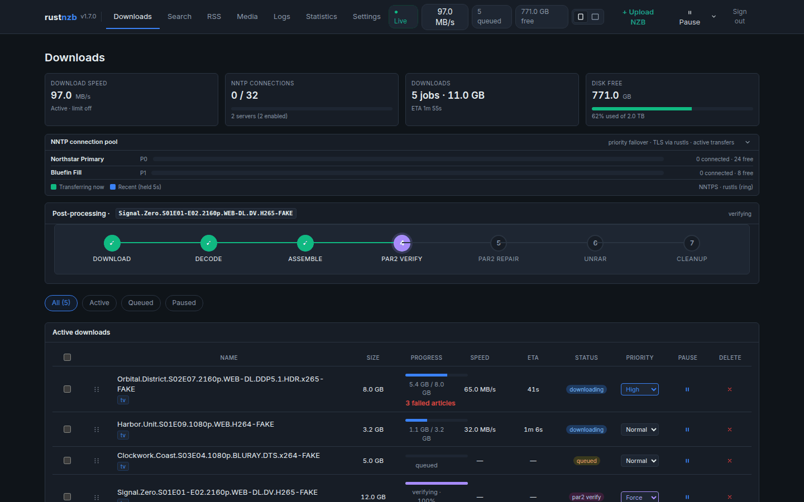
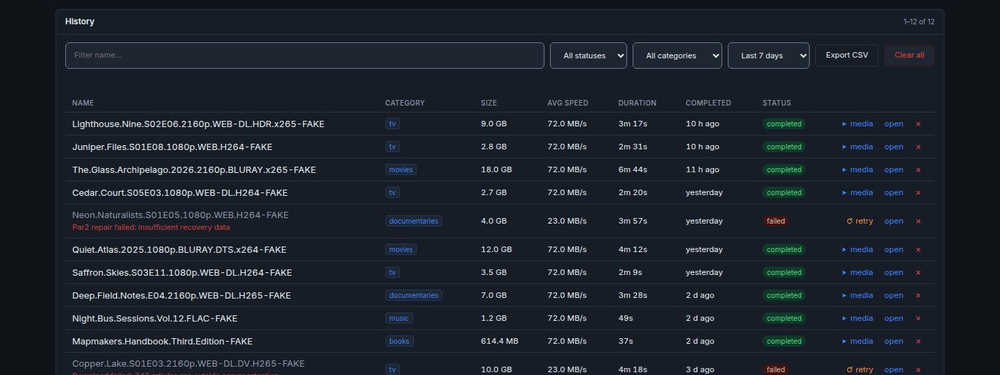
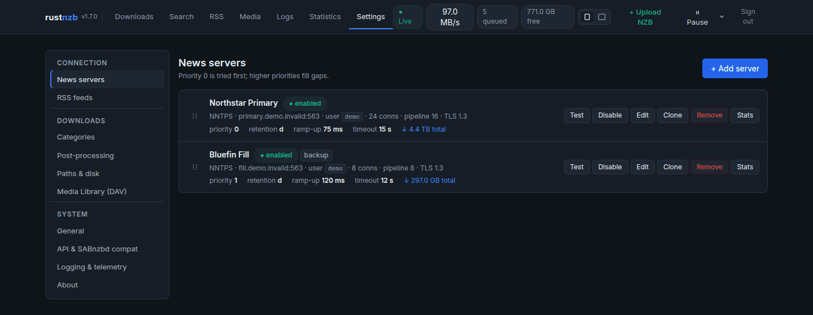
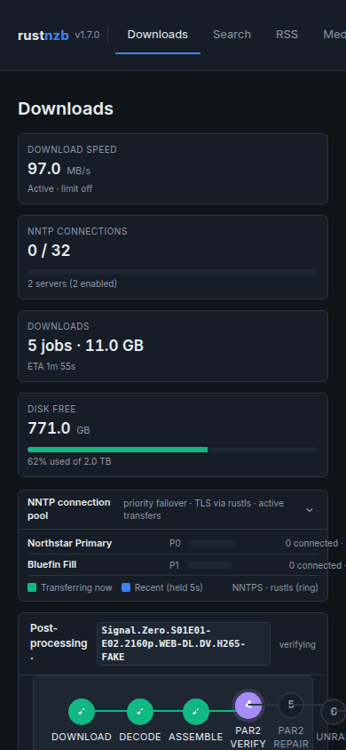

# rustnzb

**A modern Usenet downloader written in Rust.**

rustnzb takes an NZB and does the rest — pipelined NNTP downloads, SIMD yEnc
decoding, PAR2 verification and repair, and archive extraction, wrapped in a
web UI with real automation. One static binary, built for self-hosters.

[](https://www.rust-lang.org/)
[](https://github.com/TheDancingDeveloper-org/rustnzb/pkgs/container/rustnzbd)
[](LICENSE)
[](AGENTS.md)

## Try it now — live demo

**[www.rustnzb.dev/demo](https://www.rustnzb.dev/demo/)**

The demo is the complete rustnzb interface running against a simulated backend
in your browser — queue, history, statistics, newsgroup search, RSS rules, the
media library, settings, all of it. Nothing to install, no Usenet provider
required, and nothing leaves the page.

More at [rustnzb.dev](https://rustnzb.dev/) · [GitHub Releases](https://github.com/TheDancingDeveloper-org/rustnzb/releases) · [Changelog](CHANGELOG.md) · [Discord](https://discord.gg/pu6chSqpnJ)

### Screenshots



| History | Settings | Phone |
|---|---|---|
|  |  |  |

Screenshots use the demo's fictional data.

Coming from SABnzbd? See [Moving from SABnzbd](docs/MIGRATING_FROM_SABNZBD.md)
for a feature comparison and a settings import.

---

## Features

| Feature | Description |
|---------|-------------|
| **NNTP pipelining** | Multiple ARTICLE commands in flight per connection. Configurable pipeline depth per server eliminates round-trip latency. |
| **Multi-server failover** | Priority-ordered server list over TLS (rustls). Articles missing on one server are retried on the next; fill servers are only used when needed. |
| **yEnc decoding** | SIMD-accelerated yEnc decoder with CRC32 validation, streamed straight into the file assembler. |
| **PAR2 verify & repair** | Automatic verification after download. Damaged files are rebuilt from recovery blocks in pure Rust — no external par2 binary. |
| **Archive extraction** | Automatic extraction of RAR, 7z, and ZIP archives after repair, multi-part sets included, with cleanup. |
| **Overlapped pipeline** | Independent downloads, PAR2 repair, and extraction can progress together under explicit per-stage worker limits. |
| **Web UI** | Queue, history with per-download insights and undoable deletes, lifetime statistics, live logs, drag-and-drop NZB upload, and selectable themes. |
| **Automation** | RSS feeds with regex rules, a watch folder, and a newsgroup browser with header search and threaded views. |
| **Media library** | WebDAV library that streams files on demand, straight from Usenet, without downloading first. |
| **REST API** | Full HTTP API with Swagger/OpenAPI documentation, plus a compatibility API for *arr applications. |
| **Desktop app** | Native application for Windows, macOS, and Linux powered by Tauri. System tray with queue count and speed. |
| **OpenTelemetry** | Built-in tracing and metrics export via OTLP. Ship logs and metrics to Grafana, Jaeger, or any OTLP-compatible backend. |

---

## Getting started

### Docker

```bash
docker run -d \
  --name rustnzb \
  -p 9090:9090 \
  -v ./config:/config \
  -v ./data:/data \
  -v /path/to/downloads:/downloads \
  -e PUID=1000 -e PGID=1000 -e TZ=Etc/UTC \
  ghcr.io/thedancingdeveloper-org/rustnzbd:latest
```

Open `http://localhost:9090` and add your NNTP servers via the web UI.

| Variable | Meaning |
|----------|---------|
| `PUID` / `PGID` | User and group IDs that own `/config`, `/data` and the download directories, and that rustnzb runs as. Match them to the owner of your host directories (`id -u`, `id -g`). |
| `TZ` | Timezone for log timestamps, such as `Europe/London`. Default `UTC`. |

The image ships `unrar` and 7-Zip, so extraction works out of the box.

### Docker Compose

```bash
git clone https://github.com/TheDancingDeveloper-org/rustnzb.git
cd rustnzb
mkdir -p config
cp apps/rustnzb/config.example.toml config/config.toml
docker compose up -d
```

The container reads `/config/config.toml`, which the `./config` mount provides.
Downloads go to `./downloads` by default. To change that, or the host port,
timezone, or the UID/GID that owns the files, put the values in a `.env` file
next to `docker-compose.yml`:

```bash
DOWNLOADS_DIR=/srv/usenet/downloads
RUSTNZB_HOST_PORT=9095
TZ=Australia/Sydney
PUID=1000
PGID=1000
```

### Binaries

Download the latest release from [GitHub Releases](https://github.com/TheDancingDeveloper-org/rustnzb/releases):

- **Linux** — `tar.gz` (x86_64, aarch64) or `.deb` (amd64, arm64, installs a systemd service)
- **Windows** — NSIS installer
- SHA256 checksums are attached to every release

### From source

```bash
git clone https://github.com/TheDancingDeveloper-org/rustnzb.git
cd rustnzb
cp apps/rustnzb/config.example.toml config.toml
cargo build -p rustnzb --release
./target/release/rustnzb
```

Requirements: Rust 1.95+ (2024 edition), plus `7z` (7-Zip) and `unrar` on
`PATH` for archive extraction. `unrar` also enables direct unpack while
downloading. Run `rustnzb --smoke-test` to check that both work.

---

## Sonarr & Radarr integration

rustnzb speaks the download-client API that *arr applications already use —
Sonarr, Radarr, Lidarr, Readarr, and Prowlarr connect with their standard
settings.

1. In your *arr app, go to **Settings > Download Clients > Add** and select the **SABnzbd** client type
2. Set **Host** and **Port** to your rustnzb instance
3. Enter your `api_key` (if configured in `config.toml`)
4. Set **Category** to match your rustnzb categories (e.g. `tv`, `movies`)

```toml
[general]
api_key = "your-secret-key"

[[categories]]
name = "tv"
output_dir = "tv"

[[categories]]
name = "movies"
output_dir = "movies"
```

---

## Architecture

A modular Rust workspace with clean separation of concerns.

| Crate | Purpose |
|-------|---------|
| **nzb-core** | NZB parser, config, SQLite database, shared models |
| **nzb-news** | Download orchestration primitives and queue/worker coordination |
| **nzb-dispatch** | Server-aware dispatch engine that feeds article fetch work to `nzb-news` |
| **nzb-nntp** | NNTP protocol, connection pool, TLS (rustls), pipelining, server failover |
| **nzb-decode** | yEnc decoder, CRC32 validation, file assembler |
| **nzb-postproc** | PAR2 verify & repair, RAR/7z/ZIP extraction, cleanup |
| **nzb-web** | Axum HTTP server, REST API, web UI, queue manager |

### Download pipeline

```
Parse NZB
  -> nzb-web queue manager
  -> nzb-dispatch
  -> nzb-news
  -> Download (nzb-nntp pipelining, multi-server failover)
  -> Decode (yEnc + CRC32)
  -> Verify & Repair (PAR2, bounded repair workers)
  -> Extract (RAR, 7z, ZIP, bounded extraction workers)
  -> Complete
```

When one job leaves the download phase, its download slot is immediately
available to the next queued job. Post-processing uses independent global
limits (`max_post_processing_jobs`, `max_repair_workers`, and
`max_extract_workers`), so a download, a repair, and an extraction may overlap
without allowing CPU- or disk-heavy stages to grow without bound. Higher
limits increase throughput at the cost of memory, CPU, and disk contention.
Interrupted post-processing jobs resume from the post-processing boundary on
restart.

---

## Configuration

rustnzb uses TOML configuration with CLI and environment variable overrides.

**Priority:** CLI args > environment variables > TOML file > defaults

Most settings can be configured through the web UI. Every key, its default
and its environment variable or CLI flag are listed in the
[configuration reference](docs/CONFIGURATION.md);
[`apps/rustnzb/config.example.toml`](apps/rustnzb/config.example.toml) is an
annotated example.

Unknown keys are an error, and the error names the file and key. To check a
config without starting the server, run `rustnzb --config <path> --check-config`:
it exits 0 when the file is usable and 1 with the problems listed. Config files
are written with owner-only permissions (0600) because they hold passwords and
API keys.

The HTTP API exposes `/api/health` (liveness) and `/api/ready` (readiness,
503 once shutdown has begun) for probes and load balancers.

### Key environment variables

| Variable | Description |
|----------|-------------|
| `RUSTNZB_CONFIG` | Config file path. A path given here must exist; without one, the default is `$XDG_CONFIG_HOME/rustnzb/config.toml` (or `~/.config/rustnzb/config.toml`), created on first start |
| `RUSTNZB_PORT` | Listen port (see the Docker note below) |
| `RUSTNZB_LISTEN_ADDR` | Listen address |
| `RUSTNZB_DATA_DIR` | Data directory (database, RSS state, credentials) |
| `RUSTNZB_LOG_LEVEL` | Log level (trace/debug/info/warn/error) |
| `RUSTNZB_LOG_FILE` | Also write logs to this file (daily rotation, newest 7 kept); see [Logging](docs/OBSERVABILITY.md#log-file) |
| `RUSTNZB_LOG_FORMAT` | `text` (default) or `json` (one JSON object per log line) |
| `RUSTNZB_DAV_ENABLED` | Enable the Media Library (DAV) at startup |
| `OTEL_ENABLED` | Toggle for OTEL logs + metrics export |
| `OTEL_EXPORTER_OTLP_ENDPOINT` | OTLP gRPC endpoint |
| `OTEL_SERVICE_NAME` | Service name for telemetry |

> **Docker note:** to use a different host port, change only the host side
> of the mapping (`-p 9095:9090`). `RUSTNZB_PORT` moves the port *inside* the
> container, so the mapping must change to `-p <host>:$RUSTNZB_PORT` too.

### Docker volumes

| Path | Purpose |
|------|---------|
| `/config` | Configuration files |
| `/data` | Database, RSS state, credentials |
| `/downloads` | Incomplete and completed downloads |

---

## API

Interactive API documentation is available at `/swagger-ui` when the server is
running.

```bash
# Add NZB by URL
curl -X POST http://localhost:9090/api/queue/add-url \
  -H "Content-Type: application/json" \
  -d '{"url": "https://example.com/file.nzb", "category": "movies"}'

# Upload NZB file (optional fields: category/cat, priority 0-3,
# name/nzbname; each may also be passed as a query parameter, and a form
# field wins over the query)
curl -X POST http://localhost:9090/api/queue/add \
  -F "file=@/path/to/file.nzb" -F "category=tv" -F "priority=2"

# Upload an NZB with an archive password (multipart `password` field;
# `add-url` takes a JSON `password`)
curl -X POST http://localhost:9090/api/queue/add \
  -F "file=@/path/to/file.nzb" -F "password=secret"

# Check status
curl http://localhost:9090/api/status
```

Job names follow SABnzbd's inline-password convention on both APIs: a name
or NZB file name of the form `Name{{password}}` or `Name/password` sets the
job password and is queued as `Name`. An explicit `password` wins over the
inline one, which wins over a password embedded in the NZB.

The *arr-compatible API is served at `/sabnzbd/api`.

### Authenticating the SABnzbd-compatible API

A client can send the API key in the `X-Api-Key` header instead of the
`apikey` query parameter:

```bash
curl -H "X-Api-Key: your-secret-key" \
  "http://localhost:9090/sabnzbd/api?mode=queue&output=json"
```

`apikey` in the query string or a request body still works, because that is
what SABnzbd and the *arr apps send. The header is the safer form: a URL ends
up in the access logs of every reverse proxy in front of rustnzb, while a
header does not. When both are present the header wins.

---

## Development

```bash
cargo build -p rustnzb              # Debug build
cargo build -p rustnzb --release    # Release build
cargo test --workspace              # All tests
cargo test -p nzb-decode            # Single crate
```

For exact CI parity, use the checked-in container task interface:

```bash
./ci/run fmt
./ci/run check
./ci/run test
./ci/run clippy
./ci/run e2e
```

Pull requests run only the CI areas they touch; the merge queue runs the full
suite before anything reaches `main` — see [docs/ci.md](docs/ci.md).

See [docs/DEVELOPMENT.md](docs/DEVELOPMENT.md) for the full task list and
build details. See [CONTRIBUTING.md](CONTRIBUTING.md) for repository workflow
and [docs/KNOWN_ISSUES.md](docs/KNOWN_ISSUES.md) for current user-visible
limitations.

---

## AI-friendly by design

rustnzb is built to be worked on by AI coding agents as well as people, and
agent-assisted pull requests are welcome.

[**AGENTS.md**](AGENTS.md) is the entry point for any agent: it maps the
workspace crate by crate, lists the exact build and test commands, states the
project conventions, marks the compatibility surfaces that must not drift, and
sets explicit boundaries on what an agent should not do unprompted. It follows
the [agents.md](https://agents.md/) convention, so Claude Code, Codex, Cursor,
Copilot, Gemini CLI, Aider, and anything else that reads `AGENTS.md` pick it up
automatically.

What makes the repository tractable for an agent:

- **Deterministic checks.** `cargo fmt`, `cargo check`, `cargo clippy -D
  warnings`, and `cargo test --workspace` are the whole gate — no hidden steps.
- **Reproducible environments.** `./ci/run <task>` executes the same
  checked-in task scripts in the same pinned images CI uses, so local results
  and CI results agree.
- **No live dependencies in tests.** `crates/mock-nntp-server` provides a
  deterministic NNTP fixture; nothing in the test suite needs a Usenet
  provider, network access, or wall-clock timing.
- **Documented contracts.** The REST API is annotated with utoipa and served
  at `/swagger-ui`; the SABnzbd compatibility layer is checked against captured
  SABnzbd 5.0.4 golden responses, so a response-shape regression fails CI
  rather than a user's client.
- **Clear boundaries.** Small crates with narrow responsibilities, so a change
  usually touches one of them.

Contributor expectations for AI-assisted changes — reviewing the complete
change, running the tests, reporting results accurately — are in
[CONTRIBUTING.md](CONTRIBUTING.md).

---

## License

MIT

---

## Contributing and security

Contributions are welcome. Please read [CONTRIBUTING.md](CONTRIBUTING.md),
[SECURITY.md](SECURITY.md), and [CODE_OF_CONDUCT.md](CODE_OF_CONDUCT.md) before
opening an issue or pull request.
